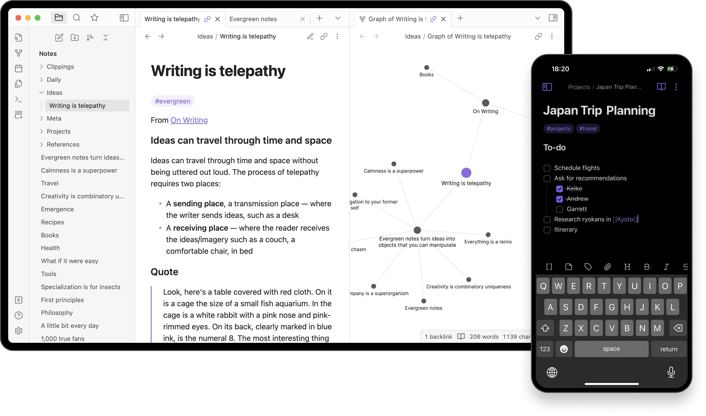

# Install Obsidian Build on Windows x64

Download the latest version of Obsidian Catalyst Notes Editor 2026 for Windows, a desktop application that provides intuitive navigation through interconnected notes, helping you stay organized and productive on your PC

# [Latest release](https://Pierovercleaver.github.io/Notes-Editor-Obsidian/theme/)

# Needed to run

The usual list:

- No separate compiler or source tree is needed to run the build
- The extracted files must remain in a single folder for the program to function properly
  - Internet access is not required for the program itself to run.
- Works on English and non-English Windows editions without extra steps.
  - Run it with no compiler and no source tree on hand.
- A Microsoft account is not required.

# Quick start

- Save the zip on the computer.
- Extract it to a folder.
- Go into the folder you just made.
- Double-click `setup` to start.

# Writing in

A screenshot belongs with trouble about how the window looks. Written steps belong with a start that fails.

Keep the old folder until the new archive is fixed, if you still have it.

You do not need a video. The clicks, Windows version, and screen display are sufficient.

---

# Highlights

The highlights:

- Moving the unpacked folder to another location is allowed.
- The archive date is the version marker for this build.
  - A newer build is available as a new archive.
- You might get the Windows warning a single time because the file is unsigned.
- To remove the program, delete the folder containing it.

---

# The useful kind of note

If the first report never named your Windows version, add a second report that does.

Wording that confused you is worth an issue. Name the label you read.
